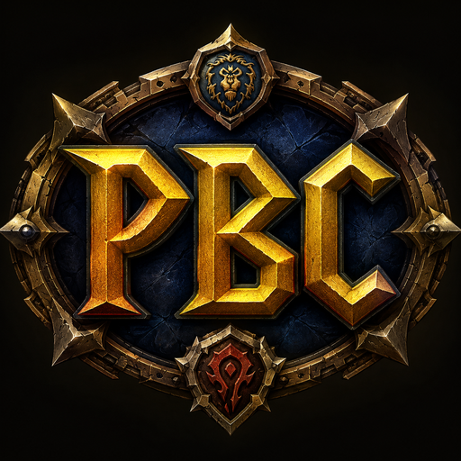

  

`mod-playerbots-characters` (or `mod-pbc` for short) is an [AzerothCore](https://www.azerothcore.org) & [Conquest of Azeroth](https://github.com/Conquest-of-AzerothCore/azerothcore-wotlk-coa) module built around [mod-playerbots](https://github.com/mod-playerbots/mod-playerbots) (CoA Companions or SQUID Playerbots for CoA), breathing new life into bots by turning them into true in-game characters — companions with pre-defined personalities, memory, and relationships. Heavily inspired by [mod-ollama-chat](https://github.com/DustinHendrickson/mod-ollama-chat), but taking a different, more complex approach — focusing on the roleplaying experience rather than emulating real WoW players.

Think old Bioware games with companions — that's the core idea. The intended use is a fresh start at low rates with a full party of altbots playing alongside you, developing their own stories as you progress through the game together.

## How It Works

This module extends the bots provided by `mod-playerbots` into full characters — giving them a voice, memories, relationships, and the ability to react to events and converse with companions. The bot logic (combat, movement, questing) remains entirely untouched; this module only adds the personality layer on top.

Characters react to in-game events (chat, item pickups, duels, level-ups, boss kills, quests) based on configurable reply chances. When a character rolls to respond, a prompt is built from its character card, chat history, relationships, live context, and the event itself — then sent to a compatible LLM API, and the response is spoken by the character in-game.

Over time, chat history grows. When it reaches the configured token limit, a condensation process extracts discrete narrator-style memories with importance scores from the history, then clears all history. These memories are selected by importance at prompt-build time within a token budget, keeping the in-memory context bounded while preserving what matters. This way, characters gradually develop lasting memories and personality traits.

Relationships are tracked between characters and real players, as well as other characters. When a name is mentioned enough times in a character's history, a relationship update is triggered — generating or updating a brief description of how the character feels about that person. These are included in future prompts, giving characters continuity with their companions.

The module supports multiple languages based on the server's `DBC.Locale` setting:
- enUS (default, picked if the needed locale is not found)
- deDE
- ruRU

## Installation

Installation instructions for both stock AzerothCore and Conquest of Azeroth, including obtaining the sources, configuration, model connection setup and recommended playerbots adjustments, can be found in [Installation Guide](docs/INSTALL.md).

## HTTP Server & Web App

The module can optionally run a built-in HTTP/WS server with a web frontend, providing an interface for managing the characters, as well as an API for external tools and integrations. The web interface supports viewing and editing chat history, relationships and memories. This is disabled by default, see the [Installation Guide](docs/INSTALL.md#http-server--web-app) for how to enable it.

## Usage

Start the server, set up some altbots for yourself or invite existing random bots, then write cards for them as you see fit. See `characters/Example.card.txt` for an example of how to write a character card. The character name in the filename must match the in-game character name exactly to be picked up. It is recommended to write cards in second person (using "you/your"), because default prompts and request structure follow this format.

Start playing, chat with your characters, discuss anything you like, build relationships and enjoy the game.

> [!NOTE]
> Depending on the model you are using, your mileage may vary. Do regular backups with `modules/mod-pbc/tools/pbc_backup.sh` and adjust things as needed either in the database (followed by `.chars reload` command) or via the included web app. There are also two helper tools (`pbc_info.sh` and `pbc_history.sh`) which might help with tracking what's going on. You can also steer the narration a bit by using `.chars narrate` and `.chars narrate-party` commands. Check out [available commands](docs/COMMANDS.md) for more info.

### Web App

If you have the HTTP server configured, you can use `.chars web` command to get a one-time password that you can then use to authorize in the web app.

## Debugging

Two config options control debug output:

- `PBC.DebugEnabled` — enables general debug logging (event dispatching, roll chances, etc.)
- `PBC.DebugShowFullRequest` — when enabled alongside `DebugEnabled`, logs the full request body and response body for every LLM API call. Useful for diagnosing issues with non-standard API providers where the response format may differ from OpenAI's.

## Additional Documentation

- [Installation Guide](docs/INSTALL.md) — setup for AzerothCore and Conquest of Azeroth
- [Model Connections](docs/CONNECTIONS.md) — LLM connection setup, supported API types and tested providers
- [Events](docs/EVENTS.md) — list of in-game events characters can react to
- [Commands](docs/COMMANDS.md) — available in-game and console commands
- [Prompts](docs/PROMPTS.md) — prompt templates, customization and template variables
- [API Reference](docs/API.md) — HTTP API and WebSocket documentation
- [Frontend](frontend/README.md) — web interface build and development

## Support & Contributing

Contributions are welcome — feel free to open a pull request. If you need help or found a bug, [open an issue](https://github.com/deseven/mod-pbc/issues/new) or [join the Discord](https://discord.gg/YE9KyTXRPt).
